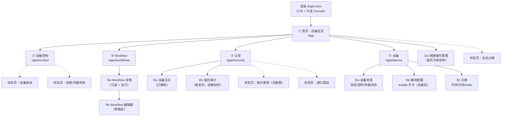

# UI v1 信息架构（页面树 / 导航 / 页面规格）

> 设计原则（决定了下面所有取舍）：
> 1. **手机竖屏一屏能看到"现在怎么样"**，不需要滚动就能回答"水在流吗、秤正常吗、连得上吗"。
> 2. **危险操作永远多一步**，安全方向的操作（关阀）永远少一步。
> 3. **页面结构由 registry 驱动**，新增 Action/查询不需要改页面代码（见 §6）。
> 4. **没有回读能力的反馈不算反馈**（见 `05-command-lifecycle.md`）——
>    界面上的"成功"必须有设备回帧支撑，否则只能显示"已下发，结果未知"。

---

## 1. 页面树



### 1.1 合并与拆分依据

| 决策 | 依据 |
|---|---|
| **日志 + 操作审计合并为"记录"页的两个 tab** | 同一个心智模型（"刚才发生了什么"），但**数据源不同**（`log_history` vs `command_audit`），混排会导致"看不出哪条是我点的" ⇒ 同页分 tab，不合并列表 |
| **Workflow 列表 / 详情 / 编辑 三级，而非列表直进编辑** | 编辑是**草稿态**且保存会**重启设备**；详情是只读 + 运行入口。两级混用会让人误点保存 |
| **设备信息 / 配置 / 诊断 合并为"设备"页三段** | 三者都是低频、都归属"当前这台设备"；分三页会让底部导航膨胀到 7 项 |
| **快捷操作不单独成页，而是首页的一个区 + 一个管理页** | 快捷的意义是"少点一次"，藏进二级页面就失效了 |
| **不做独立"设备列表"页** | 目前只有 1 台设备；多设备时用首页标题旁的设备切换器（见 §5） |

---

## 2. 导航

### 2.1 手机（< 900 px）

**底部固定 tab 5 项**（图标 + 短词，触控区 ≥ 48 px）：

```
┌─────────────────────────────────────┐
│                                     │
│            内容区（可滚动）           │
│                                     │
├─────────────────────────────────────┤
│  首页    控制    流程    记录    设备  │
└─────────────────────────────────────┘
```

- 所有页面都是 `/app` + hash 路由（`#control` / `#workflows` / `#records` / `#device`），
  **不引入客户端路由库**，刷新后仍停在同一 tab。
- 二级页（Workflow 详情/编辑、审计、诊断）从右侧推入，**顶部出现返回箭头**，底部 tab 保留。
- 返回规则：二级页 → 上一级；二级页里若有未保存修改 ⇒ 拦截并询问（见 `04` §9）。

### 2.2 桌面（≥ 900 px）

```
┌──────────┬──────────────────────────────────┬─────────────┐
│ 侧边导航  │  主内容（列表/表单/图表）           │  常驻状态栏  │
│ 首页      │                                  │ 秤 1759.9 g │
│ 控制      │                                  │ 阀 关闭      │
│ 流程      │                                  │ 在线 12 s    │
│ 记录      │                                  │             │
│ 设备      │                                  │ 最近操作     │
└──────────┴──────────────────────────────────┴─────────────┘
```

**不是把手机页面拉伸**：
- 手机上的"状态区"在桌面变成**右栏常驻**，主区腾给列表/图表
- 控制页在桌面变成**两列网格**（左：执行机构，右：传感器与配置）
- 表格在手机变卡片、在桌面变真表格
- 曲线图在桌面高度 320 px、手机 180 px

---

## 3. 页面规格（逐页）

> 每页固定包含：**用途 / 核心信息 / 主要操作 / 进入条件 / 退出方式 / 异常状态 / 与其他页面关系 / 协议支撑度**。

### ① 首页 · 设备总览

- **用途**：3 秒内回答"现在能喂吗"。
- **核心信息**
  - 大号数字：**当前重量**（`weight_value`，g）
  - 状态胶囊：**阀门开/关**（`valve_status`）、**秤有效/错误**（`weight_valid`/`weight_error`）
  - 连接行：WiFi RSSI、MQTT 是否连、**最后上行时间**
  - 今日概要：近 24 h 运行次数、累计供水（由 `telemetry_history` 差分估算，标注"估算"）
- **主要操作**：快捷操作方格（默认：开阀 / 关阀 / 跑 21 g / 秤清零）、下拉刷新
- **进入条件**：有会话
- **退出**：底部 tab 切走
- **异常状态**
  - 设备离线（`last_seen` > 300 s）⇒ 顶部黄条 + **所有控制按钮禁用**
  - 秤 `weight_error=true` ⇒ 重量数字变红 + 提示"秤数据不可信，供水流程会被强制中止"
  - 无遥测数据 ⇒ 重量区显示"—"，并给"为什么没有数据"的说明（不是空白）
- **关系**：所有其他页的入口；快捷方格 → 控制页/流程页
- **协议支撑度**
  - 重量/阀/秤：**`snapshot` 的 `telemetry_latest` 可给重量**；`valve_status`/`weight_valid` **必须下发 `query_state`**（D1 里没有）⇒ **[待实现]**
    一个聚合端点或"最近一次 query 结果缓存"才能做到 5 s 刷新不多发命令

### ② 设备控制

- **用途**：手动执行所有受支持动作。
- **核心信息**：按**能力分组**的按钮矩阵
  ```
  供水    [开阀] [关阀]
  称重    [秤清零]
  出粮    [出粮 120°] [指定脉冲] （标"未验证"）
  振动    [启动] [停止]         （标"未验证"）
  测试    [步进测试 启动/停止]   （默认折叠，标"排障用"）
  ```
- **主要操作**：点击 → （危险项）二次确认 → 下发 → 显示生命周期状态
- **进入条件**：在线 + registry 已加载
- **退出**：tab 或返回
- **异常状态**
  - registry 里**没有**某个 Action（例：阀门被禁用）⇒ 该按钮**不渲染**，并在组标题标"该模块已禁用"
  - 参数非法 ⇒ 就地红字，**不发命令**
  - 命令进行中 ⇒ 该按钮转"执行中"，其它按钮按风险决定是否禁用
- **关系**：↔ ① 首页快捷；↔ ④a 日志（看这次动作产生的设备事件）
- **协议支撑度**：下发 ✔；**结果回读 ✘（G-1）**
  - 参数用 `p:{...}`（扁平键），**不是** `p.o`

### ③ Workflow 列表 / ③a 详情 / ③b 编辑

- **列表用途**：看到全部流程及其**当前状态**（`IDLE/RUNNING/TIMEOUT/…`）与步数。
- **列表核心信息**：名称、`stable_id`（slot）、步数、状态、`current_step`、是否 `enable`
- **列表操作**：新建 / 运行 / 详情 / （卡片长按）复制
  - **复制 = 读取定义后用新 id 创建**（`get` + `create`），**不是**原生接口 ⇒ 标"组合实现"
- **详情用途**：只读展示步骤 + **运行/停止说明**
- **编辑**：见 `04-workflow-editor.md`
- **异常状态**
  - `state=RUNNING` ⇒ 运行按钮禁用并显示"进行中（第 n/m 步）"
  - `state=TIMEOUT` ⇒ 提示"上次超时结束，可重新运行"（**这是残留状态，不代表在跑**）
  - **注意：MQTT 侧没有 stop 命令（G-5）** ⇒ 详情页必须写"无法从 App 中断，需等超时或现场重启"
- **协议支撑度**：列表/详情/创建/改/存 ✔；**中断 ✘**

### ④ 记录（④a 日志 / ④b 审计）

- **④a 日志用途**：看懂设备发生了什么。
- **核心信息**：时间、级别、**事件中文名 + 参数**（解码后）、`boot/seq`
- **过滤**：级别、事件类别（阀门/秤/流程/网络/配置）、关键字；分页（`before_id`）
- **异常状态**
  - **解码失败** ⇒ 显示 `未知事件 0x0509` + 原始 payload 折叠区（**不能整行消失**）
  - 空数据 ⇒ 说明"设备可能没开日志上云（`mqtt.telemetry_enable`）"
- **④b 审计用途**：谁在什么时候点了什么，结果如何
- **核心信息**：时间、操作、对象、结果（成功/失败/未知）、耗时、IP 哈希前 8 位
- **协议支撑度**
  - 日志：**必须先实现 Worker 端解码**（G-2 无关，属 M4）
  - 审计：**需要新表 `command_audit` + 新读端点**（M1/M2）

### ⑤ 设备

- **⑤a 信息**：device_id、固件版本、state、最后在线、凭据四态、ACL 就绪
- **⑤b 模块配置**：`valve/weight/stepper/vibration/oled/rtc/mqtt/telemetry` 的 `enable`
  - **每个开关两步**（`config_set` → 确认 → `config_save` → **设备重启 ~40 s**）
  - 关闭 `valve`/`weight` 会**改变 Action 列表**，弹窗明确写出"将导致对应按钮消失（registry 版本变化）"
- **⑤c 诊断**：`memory` / `flash` / `stats` / `loop`（只读）
- **异常状态**：配置保存失败（LittleFS 写失败）、重启后 40 s 内页面进入"正在重启"态
- **协议支撑度**：全部 ✔（`config_*`、`memory/flash/stats`）

### 状态页（必须是真页面，不是 toast）

| 状态 | 触发 | 呈现 |
|---|---|---|
| 会话过期 | 任何请求 401 | 全屏说明 + "重新登录"（保留 `next`） |
| 权限/凭据失效 | Snapshot 无 device 记录 / 403 | 说明 + 联系方式（不显示空白表格） |
| 设备离线 | `last_seen` > 300 s | 顶部常驻黄条 + 控制禁用 + "最后一次上报 xx 前" |
| 首次使用 | 三张表皆 0 行 | 引导"先在设备上开遥测"（写明是哪个配置项） |
| 接口错误 | 5xx | 卡片显示 `error` 原文 + 重试按钮（**不要吞掉**） |

---

## 4. 跨页面规则

| 规则 | 约定 |
|---|---|
| 页面返回 | 二级页顶部返回箭头；浏览器返回键等价（用 `history.pushState`） |
| 未保存拦截 | 编辑页离开时若有改动 ⇒ 三个选项：保存并离开 / 放弃 / 留下 |
| 跨页跳转 | 日志里点"查看该流程" → Workflow 详情；审计里点命令 → 展开原始回帧 |
| 刷新保持 | hash 路由 + 当前设备写 `localStorage` |
| 数据新鲜度 | 每张卡片自带"xx 秒前"；**不允许**只显示无时间戳的绝对值 |

---

## 5. 设备上下文

| 项 | 设计 |
|---|---|
| 当前设备 | `?d=<device_id>`；缺省用 `localStorage.gf_last_device`；再缺省用 snapshot 里唯一设备 |
| 单设备时 | 标题只显示"Guo Feeder"，**不显示切换器**（避免制造"有多台"的错觉） |
| 多设备时 | 标题变成下拉；切换 = 重载当前 tab，不改 hash |
| 上下文保持 | 所有请求显式带 `device_id`，**不允许**后端隐含"默认设备" |
| 不一致保护 | 若 URL 的 `d` 与 registry 里的设备不一致 ⇒ 拒绝渲染控制页 |

---

## 6. 可扩展性：新增能力不改页面结构

**控制页由 registry + 元数据目录驱动**：

```
registry (设备)  {v, actions:{NAME:k}, workflows:{name:k}}
        +
元数据目录 (云端，带版本)  {NAME → {中文名, 分组, 参数 schema, 风险级别, 验证状态}}
        ↓
渲染：分组 → 按钮 → 点击后按 schema 生成参数表单 → 风险级别决定确认强度
```

- **新增 Action**：只改元数据目录（加一条），页面不改代码
- **新增 Workflow 类型**：列表卡片从 registry 自动出现
- **新增查询项**：状态页的"更多状态"从 `query_state` 键表驱动（键表在元数据目录里声明）
- **未知 Action**（设备有、目录没有）：渲染为**禁用按钮** + "该功能未在本版本 App 中支持"
  ⇒ **绝不猜测参数、绝不发半成品命令**

★ 元数据目录必须**带版本号**，且与固件 `log_events.h` / 描述符变更同步——
这条与"日志码表"是同一类问题，见 `07-log-decode.md` §7。

---

# 附录 A · v1.1 修订（2026-10-23）

> 本轮在原页面树上**增量扩展**，不推翻 §1~§6。页面树以 `page-tree.mmd` 的 v1.1 为准。

## A.1 新增页面（8 个）

| 页面 | 父级 | 用途 | 关键约束 |
|---|---|---|---|
| **①a 布局管理** | 首页 | 模块显隐+排序、快捷操作 0~12 | 安全四要素不可隐藏（`12` §1.3） |
| **②b 危险确认弹层** | 控制页 | 开阀/出粮/强停的二次确认 | 必须显示别名 + 当前重量 + 关阀倒计时 |
| **③c 执行中面板** | Workflow 详情 | 当前步、剩余时间、**强制停止** | 强停必须有 `partial` 分支（`11` §3） |
| **⑤0 设备详情 · 概述** | 设备 | 固件/最后在线/critical/重启态 | 只在 `restart_status` 页展示 critical 计数 |
| **⑤b 模块详情 × 10** | 设备详情 | 每模块状态/开关/操作/参数 | 参数目录来自 `12` §3，**不得臆造范围** |
| **⑤c 别名编辑** | 设备详情 | 改别名 | 别名不影响路由（`12` §5） |
| **⑤d 保护区** | 设备详情底部 | 普通重启 / **强制重启** / 恢复核查 | 必须滚动才能到达；强重启需输入别名末 4 位 |
| **④b 操作审计（升级）** | 记录 | 按 `cmd_id` / 风险级 / 结果筛选 | 保留 90 天 |

## A.2 新增状态页（3 个）

| 状态 | 触发 | 行为 |
|---|---|---|
| **能力同步中** | 首次进入 / 上线 / 保存后 | **阻断**所有控制命令（需求红线） |
| **能力同步失败** | 超时 > 8 s | 进入**只读模式**，仅可看数据 |
| **版本冲突** | 连续 2 次 `e=3 s=4` | 显示本地 v 与设备 v，提供人工重同步 |

## A.3 控制页的变更（§3.5 的落地）

| 变更 | 说明 |
|---|---|
| **移除**「秤清零」 | 移到电子秤详情（需求明确） |
| **新增**「指定脉冲」 | 参数来自设备 `stepper.max_pulses`（不是硬编码 6400） |
| **新增**「振动 启动/停止」 | 标注「未验证」（硬件未验证） |
| **保留**「步进测试 启动/停止」 | 标注「未验证 · 仅排障」 |
| **不新增**「按克供水」 | 需求明确不做；改 Workflow 参数后运行 |
| 每组标题右侧加**能力徽标** | `已验证` / `未验证` / `不可用`（来自元数据目录） |

## A.4 首页的变更（§3.3 / §3.4）

| 变更 | 说明 |
|---|---|
| 标题显示**别名**，副标题 `…<id后4位>` | 别名未设置时显示「设备 xxxx」 |
| 在线时长按 `13` §1.3 格式化 | 禁止裸秒数 |
| 离线时改显示「最后在线 X 前」 | 时长停止递增 |
| 快捷操作改为**流式网格**，0~12 个 | 超过 6 个自动折叠为「更多」 |
| 新增「进行中命令」条（最多 1 条） | 永不折叠 |

## A.5 导航未变

底部 5 tab 保持不变（首页/控制/流程/记录/设备）。
模块详情、保护区都是**二级/三级**，不占 tab。

## A.6 桌面/平板

本轮**不作为验收要求**。`layout.html` 保留三断点示意，但明确标注：
- 手机竖屏 = 唯一验收范围
- 结构上通过「模块注册表 + 顺序数组」解耦，未来重排不改业务逻辑
