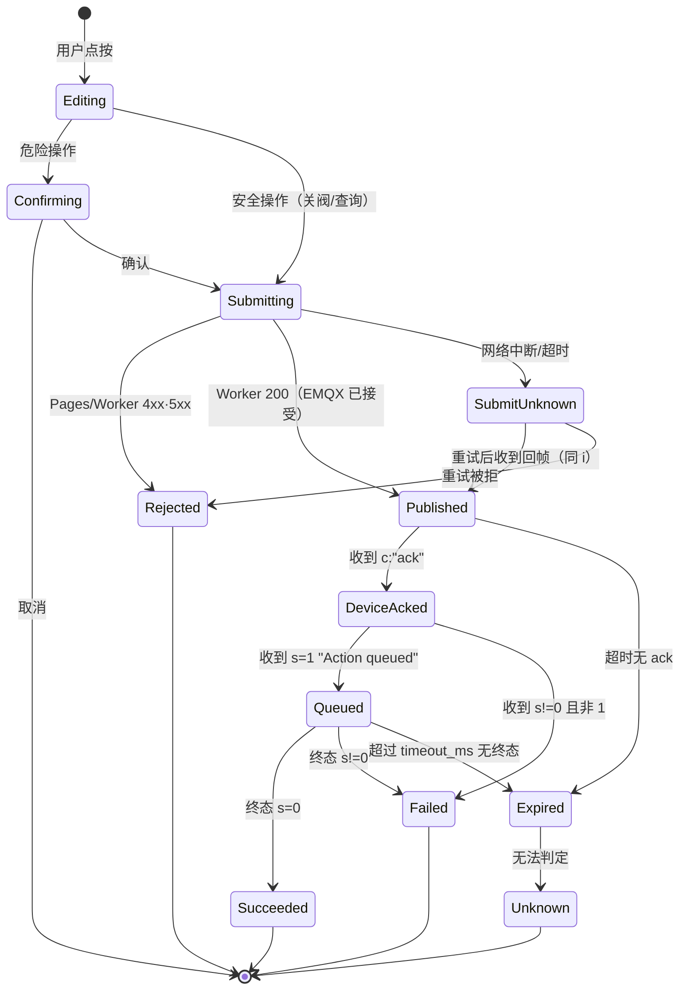

# 命令交互与幂等设计

> 核心立场：**"发出去了" ≠ "设备收到了" ≠ "执行成功了"。**
> 界面上的每一个绿勾都必须有明确的数据来源；没有来源就显示"未知"，不许猜。

---

## 1. 命令生命周期（完整状态机）



### 1.1 九态定义与**可观测性**

| # | 状态 | 含义 | 能否可靠观测 | 依据 |
|---|---|---|---|---|
| 1 | **Editing** | 用户点了，还没发 | ✅ 纯前端 | — |
| 2 | **Confirming** | 等二次确认 | ✅ 纯前端 | — |
| 3 | **Submitting** | 请求在途中 | ✅ 前端 `fetch` 状态 | — |
| 4 | **Rejected** | 服务端拒（4xx/5xx） | ✅ HTTP 状态码 | Worker/Pages 都会给 |
| 5 | **Published** | EMQX 接受了发布 | ✅ **但当前拿不到证据** —— Worker 只回纯文本 `"OK"` | `index.js:905` |
| 6 | **DeviceAcked** | 设备回 `c:"ack"` | ✅ **原理可观测**（`mqtt_messages` 里有 `c:"ack", i:<cmd_id>`）<br/>❌ **当前无端点可读** | 需新增端点（§5） |
| 7 | **Queued** | 设备受理（`s=1`, `m="Action queued"`, 含 `instance_id`） | 同上 | 同上 |
| 8 | **Succeeded/Failed** | 终态（`type:"action_result"`, `s=0` 或 `s≠0`） | 同上 | 同上 |
| 9 | **Expired / Unknown** | 超时 / 无法判定 | ⚠️ **只能推断**（"在窗口内没看到回帧"） | 见 §3.4 |

### 1.2 ★ 必须承认的两条硬事实

**事实 A：当前的 `Published` 连"EMQX 收到"都证明不了全部情况。**
Workers 返回 200 只代表 `publishToDevice()` 返回 `ok:true`，
不代表设备在线、不代表 QoS 送达。`no_matching_subscribers` 这种情形
（历史上 `P-2` 缺陷就是它）在 EMQX HTTP API 里**仍可能返回成功**。

**事实 B：`Expired` / `Unknown` 是不可消除的。**
设备只在"收到并处理"时回帧；**去重命中、`i` 缺失、设备离线、QoS 丢失都不会有任何回帧**
（`cloud_manager.cpp:1567-1576`）。所以"没回帧"至少有 4 种成因。

⇒ 设计结论：**界面必须把 `Unknown` 当成一等状态**，不能折叠成"失败"或"成功"。

---

## 2. 幂等：一次点击 = 一个 `cmd_id`，永不重复使用

### 2.1 `cmd_id` 生成规则

```
cmd_id = <前缀>-<uuid-v4 前 22 位>     例：va-7f3c9e21b04d4a6f8c1e2d
```

- **在进入 `Submitting` 之前生成一次**，之后整条链路复用（重试也用同一个）
- 前缀标类别：`vo`(开阀) `vc`(关阀) `wz`(秤清零) `wf`(流程) `cs`(配置) `q`(查询)
  —— 便于在日志里肉眼定位
- 长度上限：设备侧未限制，但 `mqtt_messages` 会存原文 ⇒ 控制在 **32 字符内**

### 2.2 为什么必须"一次点击一个 id"，而不是"重试就换新 id"

| 做法 | 后果 |
|---|---|
| 重试换新 id | 若第一次其实已送达 ⇒ **同一动作执行两次**（开阀两次、跑两遍流程） |
| 重试复用 id | 30 s 内命中设备去重 ⇒ **静默丢弃**（无回帧，但也不会重复执行）✅ |
| 重试复用 id（>30 s 后） | 去重已过期 ⇒ **会真的再执行一次** ⚠️ |

⇒ **规则**：
1. 重试**必须复用同一 `cmd_id`**
2. 重试**只允许在 30 s 内**（设备去重窗口内）自动进行
3. 超过 30 s 的一律**交给用户决定**，且必须提示"设备可能已执行过，请先核对状态"

### 2.3 连续点击的防护（三道）

| 层 | 机制 |
|---|---|
| 前端 | 按钮在 `Submitting`/`Published`/`Queued` 期间**禁用**；同类别（如开阀）加 1.5 s 冷却 |
| 前端 | 同一 `cmd_id` 的请求**串行化**（同一时刻只有一个在途） |
| 服务端（拟议） | Pages 侧对 `(actor, kind, object)` 做 2 s 去重窗口；超出返回 `429 duplicate_suppressed` 并回带原 `cmd_id` |

★ 第三道是必须的：前端禁用可被"刷新页面 + 再点"绕过。

### 2.4 设备去重窗口的真实语义（写进设计文档，提醒所有人）

```
去重缓存：FIFO 10 条，TTL 30 000 ms
  · 命中 ⇒ Serial "[Cloud] Command duplicate" ⇒ 无 ack、无 result
  · 10 条是全局共享的 ⇒ 并发 10 条命令就能把真实命令挤出去
```

⇒ 因此 **`timeout_ms` 与去重窗口必须分清**：
- 去重窗口 30 s 决定"同 id 会不会被执行两次"
- 运行时超时 600 s 决定"执行本身能跑多久"
- 两者相差 20 倍，**不能互相替代**

---

## 3. 各状态的超时与边界行为

### 3.1 时间预算（建议值，可调）

| 阶段 | 预算 | 超时后 |
|---|---|---|
| `Submitting`（HTTP） | 10 s | → `SubmitUnknown`，允许复用 id 重试一次 |
| `Published → DeviceAcked` | 15 s | → 显示"设备未应答"，再等 15 s 后转 `Expired` |
| `Queued → 终态` | 设备侧 `timeout_ms`（Action 600 s / Workflow 定义值） | → `Expired`，提示"仍在运行或已卡住，请查状态" |

★ 为什么 `Published → DeviceAcked` 只给 15 s：EMQX 到设备的 RTT 实测在百毫秒级，
15 s 已经远超；再长只会让用户以为卡死。**但 15 s 后不判定失败，只判定"未应答"。**

### 3.2 迟到回帧

场景：页面已显示 `Expired`，30 s 后 `ack` 到了。

- **允许**：把卡片从 `Expired` 提升为 `DeviceAcked` 并继续推进（因为这是同一 `cmd_id` 的真实证据）
- **必须**：标注"（迟到 30 s）"，避免用户以为"15 s 的预算"是错的
- **不允许**：把迟到的 `result` 应用到一个**已经换了 cmd_id** 的新操作上

⇒ 前端维护 `Map<cmd_id, 状态>`，**按 cmd_id 匹配**，绝不按"最近一次操作"匹配。

### 3.3 页面刷新 / 会话过期

| 情形 | 行为 |
|---|---|
| 刷新 | 从 `localStorage` 恢复未终结的 `cmd_id` 列表（最多 10 条，TTL 10 min），继续轮询对应回帧 |
| 会话过期（401） | **不丢弃**在途记录；重新登录后回到原 tab 继续查询 |
| 换设备 | 未终结记录按 `device_id` 分组，切回来仍可见 |

### 3.4 `Unknown` 的处置规则（最关键的一条）

```
若 命令属于「危险操作」（开阀 / 跑 Workflow / 秤清零）
   且 状态为 Expired 或 SubmitUnknown
   则：
   ① 立即查询设备实际状态（valve_status / query_workflows / snapshot）
   ② 若查到"确实已生效"（阀已开 / 流程在跑）⇒ 转 Success 并提示
   ③ 若查到"确实没生效" ⇒ 转 Failed（可安全重试）
   ④ 若查不到（设备离线） ⇒ 保持 Unknown
      · 显示醒目提示：「无法确认是否已执行，请到现场确认后再操作」
      · 【禁止】自动重发
      · 【禁止】允许"再点一次"来覆盖 —— 必须走"我已知晓，重新发起"按钮，
        且生成**新** cmd_id（因为旧的已经超出去重窗口）
```

**这是全篇最重要的一条**：危险操作的 `Unknown` **只能用人的判断收尾**，
因为自动重发可能造成真实的水漫出来。

---

## 4. 风险分级与确认强度

| 级别 | 判定依据 | 代表操作 | 交互 |
|---|---|---|---|
| **S（安全方向）** | 关闭/停止类 | `VALVE_CLOSE`、`VIBRATION_STOP`、`STEPPER_EMERGENCY_STOP` | **单击直接执行**，无确认，无冷却 |
| **M（可逆/低风险）** | 查询、只读诊断、`WEIGHT_ZERO`（空载可重做） | `query_state`、`memory`、`WEIGHT_ZERO` | 单击执行；`WEIGHT_ZERO` 加一句"请确认空载" |
| **H（危险）** | 会让水/粮/振动**实际发生** | `VALVE_OPEN`、`STEPPER_DISPENSE_ROTATE`、`STEPPER_ROTATE_STEPS`、`VIBRATION_START`(持续)、跑 Workflow | **必须二次确认**；按钮文字写清后果；确认按钮延迟 800 ms 可点 |
| **C（配置类，会重启）** | `config_set`+`config_save`、`workflow.save` | 模块开关、保存流程 | 二次确认 + **明确"设备将重启约 40 s"** + 重启倒计时 |

**风险级别的来源**：元数据目录的 `risk` 字段（`02-capability-catalog.md` §2.4）。
**不允许**从按钮文字/名称推断风险（例如 `TEST_STEPPER_START` 听起来无害，
实际会让电机常通电 —— 它是 H）。

### 4.1 危险确认框的统一结构

```
标题：⚠ <动词><对象>
正文：能否撤销、真实后果、设备的自动保护、预计时长
次要信息：目标设备 id（多设备时防点错）
按钮：[取消]  [<明确的动作词>]（800 ms 后可用）
```

---

## 5. 缺失能力与拟议补法

### 5.1 必须有：命令回帧查询端点（G-1）

**为什么现在做不了**：全仓没有任何端点读 `mqtt_messages` 的行（只有 `COUNT(*)`）。

**拟议**（M1 实施，本轮不写代码）：

```
GET /api/admin/device/:id/command-log?cmd_id=<id>
    → 200 {
        items: [
          { direction:"down", cmd:"action", object:"VALVE_OPEN", ts:…, payload:{…} },
          { direction:"up",   cmd:"ack",    object:"VALVE_OPEN", ts:…, payload:{c:"ack",i:…} },
          { direction:"up",   cmd:"result", object:"VALVE_OPEN", ts:…, payload:{s:1,…instance_id:3} },
          { direction:"up",   cmd:"result", object:"VALVE_OPEN", ts:…, payload:{s:0,type:"action_result"} }
        ],
        terminal: true|false,
        device_online: true|false
      }
```

- 鉴权：`ADMIN_API_TOKEN`（与其它 admin 端点一致）
- Pages 白名单加一条：`admin/device/<id>/command-log`
- 依赖：`mqtt_messages` 里有 `i` 字段（**[待验证 V-3]**：需确认真实回帧行里
  `raw_payload` 含 `"i":"<cmd_id>"`，以及 `cmd`/`object` 列是否稳定填充）
- 兜底方案（若 `cmd`/`object` 列不可靠）：用 `raw_payload LIKE '%<cmd_id>%'` 检索，
  并在端点内解析 JSON 判定 `c` 与 `s`

### 5.2 建议改：Worker 成功响应带关联信息

现在：`200 "OK"`（纯文本）→ 无法知道 message_id、无法知道 QoS。
建议：`200 {"ok":true,"cmd_id":"…","device_id":"…","topic":"…","publish_ms":12,"at":1792704528}`
（`cmd_id` 从请求体透传，Worker 不生成）

### 5.3 责任划分（谁负责证明哪一段）

| 阶段 | 负责方 | 能证明什么 | 不能证明什么 |
|---|---|---|---|
| 请求被接受 | Pages | 会话有效、CSRF 通过、限流未触发 | 设备存在 |
| 已发布到 EMQX | Worker | EMQX HTTP API 返回成功 | 设备在线、QoS 送达 |
| 设备已收到 | 设备（`ack`） | 设备解包成功 | 参数合法 |
| 已受理 | 设备（`s=1`） | 参数过校验、进入队列、拿到 `instance_id` | 执行成功 |
| 执行结果 | 设备（终态 `result`） | 真实成败 | 现场物理效果（阀是否真出水） |
| 物理效果 | **只能靠人/传感器** | — | — |

★ 最后一行必须写进 UI 文案：**"执行成功"不等于"真的出水了"**，
想确认出水量只能看重量变化（`telemetry` 曲线）。

---

## 6. 边界行为矩阵（开发前先对齐全表）

| 情形 | 前端 | 服务端 | 设备 | 用户看到 |
|---|---|---|---|---|
| 连点 5 次开阀 | 第 1 次后禁用按钮 | 2 s 去重，返回原 cmd_id | 只执行 1 次 | "已下发"→"设备确认"→"成功" |
| 网络断，请求未达 | 10 s 超时 → SubmitUnknown | 无记录 | 未收到 | "网络异常，未确认是否下发"（可重试同 id） |
| 网络断，请求已达但响应丢 | 同上 | 有记录 | 会执行 | 重试同 id ⇒ 设备去重 ⇒ 无回帧 ⇒ **仍 Unknown**<br/>⇒ 必须查设备状态收尾 |
| 设备离线 | — | publish 可能仍 200 | 不发 | "设备未应答"（15 s）→ Expired |
| 设备收到但参数非法 | — | — | `s≠0` + `e/m` | 显示设备原文 + 中文解释 |
| 命令执行 8 分钟 | — | — | 仍 RUNNING | "执行中 8:12"，允许离开页面 |
| 结果未知时用户刷新 | 恢复记录并继续轮询 | — | — | 状态未丢 |
| 会话过期在途 | 跳登录，保留记录 | — | — | 登录后回到原状态 |
| 迟到回帧 | 按 cmd_id 匹配提升状态 | — | — | "（迟到 30 s）成功" |
| 设备重启导致回帧丢失 | — | — | 重启丢弃 | Expired → 查状态收尾 |

---

## 7. 反模式清单（实现时对照）

| ❌ 反模式 | 为什么错 |
|---|---|
| 把 HTTP 200 显示成"成功" | 只证明 EMQX 接受 |
| 超时后自动换新 id 重发 | 可能重复执行真实动作 |
| 用"最近一次操作"匹配回帧 | 迟到回帧会张冠李戴 |
| 把"没有回帧"一律记为失败 | 4 种成因，其中 2 种其实已执行 |
| 危险操作失败就自动重试 | 放水类动作不可自动补偿 |
| 用 toast 展示最终结果 | 会消失，用户回来看不到 |
| 关阀也弹二次确认 | 违背"安全方向要最快" |
| 只在前端做连点防护 | 刷新即绕过 |
