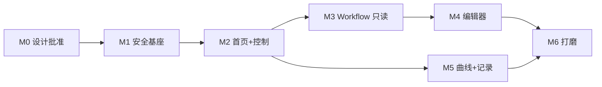

# 修订后的里程碑与验收

> 对原 M1–M4 的修订原因：
> 原 M2 把「状态区 + 控制区 + registry 查表 + 二次确认 + 操作日志」压在一个里程碑里，
> 而其中「registry 查表」与「操作日志」各自都需要后端新端点/新表 —— 实际是后端工程，
> 不是界面工程。混在一起会导致"页面做完了但点不动"。
> ⇒ 拆成 **M1（后端基座）→ M2（首页+控制）→ M3（Workflow 只读）→ M4（编辑器）→ M5（数据与记录）→ M6（打磨）**。

---

## M0 · 产品设计批准门（**本轮**，必须由用户裁决）

| 项 | 内容 |
|---|---|
| **目标** | 让用户能对页面树、页面示意、编辑器方案、命令状态模型、技术选型作出裁决 |
| **前置** | 无 |
| **范围** | 本文档集 + `docs/ui-v1/prototype.html` + `layout.html` |
| **明确不含** | 任何生产代码、迁移、部署、设备命令 |
| **安全约束** | 原型**纯静态**，不含密钥、不连真实接口 |
| **完成标准** | 用户对 §11 的 6 个待裁决项给出答复；未答复前**不得进入 M1 之后的任何编码** |

---

## M1 · 安全基座与命令可观测（**纯后端**）

| 项 | 内容 |
|---|---|
| **目标** | 堵住匿名命令入口；让"命令是否被执行"第一次可被观测 |
| **前置** | M0 批准；Q1–Q5 已裁决 |
| **范围** | ① Worker `cloud_api` 分支加 Bearer（复用 `authorizeAdmin`） ② `/api/command` 纳入会话保护（401 JSON，不是 302） ③ Pages 服务端注入 `ADMIN_API_TOKEN` ④ 写入口 Origin / Sec-Fetch-Site / Referer 校验 ⑤ 会话吊销（`ui_session` 表 + fail-closed 写路径） ⑥ 限流分桶（登录 / 命令 / 危险命令 / 读） ⑦ 迁移 `0008_command_audit.sql` + 审计写入 ⑧ **命令回帧只读端点** `GET /api/admin/device/:id/command-log?cmd_id=` ⑨ Worker 成功响应改为 JSON（含 `cmd_id`/`topic`/`publish_ms`） |
| **明确不含** | 任何界面改动（`app.html` 保持原样可用）；不解码日志；不做 registry 端点 |
| **安全约束** | EMQX 三条 webhook 入口**一行不动**；`ADMIN_API_TOKEN` 不出现在任何前端产物；`command_audit` 不存明文 IP/密码/token |
| **自动化验收** | `node --test tests/pages/*.mjs` 全绿 + 新增 `tests/pages/pages_command_auth.test.mjs`： · 匿名 `POST /` ⇒ 401 · 无会话 `POST /api/command` ⇒ 401 JSON · 跨源 Origin ⇒ 403 · 超限 ⇒ 429 · 正常 ⇒ 200 · 登出后旧 cookie ⇒ 401 · 审计行按 cmd_id 唯一 |
| **真机验收** | **L1→L4 分层**（见 `06` §7）： · L1 用 `query_state valve_status`（无害） · L2 `wrangler tail` 看 `[cloud_api] published … topic=guo_feeder/<id>/down` · L3 串口看到 `[Cloud] MQTT RX` · L4 串口 `UP-RESULT` + `command_audit.state=succeeded` · **禁止**用 `VALVE_OPEN` 做鉴权验收；最多用 `VALVE_CLOSE` |
| **已知限制** | 限流仍是 per-isolate（非全局配额）；`command-log` 依赖 `mqtt_messages` 里 `i` 字段可检索（[待验证 V-3]），不可靠时退化为 `raw_payload LIKE` |
| **完成标准** | ①匿名入口全拒 ②UI 现有只读看板仍正常 ③一条命令能在 `command_audit` 里走完 `accepted→published→succeeded` ④`command-log` 能返回该命令的 4 条帧 |

---

## M2 · 首页状态 + 控制页

| 项 | 内容 |
|---|---|
| **目标** | 手机上能"看一眼状态、点一下关阀/开阀"，并且**知道命令到底成没成** |
| **前置** | M1 全部完成（尤其 ⑧ 回帧端点 + ⑦ 审计表） |
| **范围** | ① `assets/` 目录化（拆掉单文件） ② 顶栏（在线/最后上报/登出）+ 底部 5 tab ③ 首页：重量大数字、阀/秤胶囊、连接行、最后上报、快捷方格 ④ 控制页：按能力分组的按钮矩阵（含"未验证"标记） ⑤ `catalog.js` 元数据目录 v1（14 Action + 3 Trigger） ⑥ registry 只读端点 + 60 s 缓存（**新增**） ⑦ 二次确认（H/C 级）+ 命令九态卡片 ⑧ 审计写入与"最近 5 条操作" |
| **明确不含** | 图表、日志解码、Workflow 编辑、PWA、`config_*` 配置开关（放在 M3/M5） |
| **安全约束** | 关阀**不**二次确认；危险操作确认按钮延迟 800 ms；断线时控制全禁用；危险项 `Unknown` 禁止自动重发 |
| **自动化验收** | · `catalog.js` schema 校验：全部 Action 的参数名与固件描述符一致（用导出的对照表断言） · `store.js` 九态转移单测（含迟到回帧、刷新恢复） · 危险项在 `running/unknown` 时按钮禁用（DOM 断言） · registry 缺失某 Action ⇒ 该按钮不渲染 |
| **真机验收** | · 开阀 → 确认 → 串口看到 RX/ACK/queued/终态 → UI 四段状态依次出现 · 关阀单击即执行，无确认 · 故意断网 → 显示"未确认是否下发"，**不自动重发** · 关掉 `valve.enable` 后重启 → 开/关阀按钮消失（registry 变化） |
| **已知限制** | registry 响应无 `boot_seq` ⇒ 缓存只能靠 TTL + `version mismatch` 主动失效；`vibration` 无状态键 ⇒ 只能显示"最近一次操作" |
| **完成标准** | 手机竖屏**不滚动**即可看到"重量/阀/秤/在线"；从点击到看到"设备已确认"≤ 5 s；`command_audit` 与实际操作一一对应 |

---

## M3 · Workflow 列表 + 详情（只读 + 运行）

| 项 | 内容 |
|---|---|
| **目标** | 能看流程、能运行、能看懂"上次为什么失败" |
| **前置** | M2（复用 catalog、registry、命令状态机） |
| **范围** | ① 列表卡片（状态/步数/`current_step`） ② 详情：步骤只读展示 + 运行按钮 + "第 0 步不执行"说明 ③ 运行确认框（危险流程加长文案） ④ 运行后状态跟踪（`query_workflows` 30 s 轮询） ⑤ "无法中断"的明确说明 |
| **明确不含** | 编辑、复制、删除、保存（全部在 M4） |
| **安全约束** | `RUNNING` 时运行按钮禁用；`TIMEOUT` 必须标注"上次超时"；运行确认必须写清"会真的放水" |
| **自动化验收** | · `RUNNING`/`TIMEOUT`/`ERROR` 三种状态渲染断言 · 运行按钮在 `RUNNING` 时 disabled · 危险流程判定（含 `VALVE_OPEN` 且 `timeout_ms>60s`）⇒ 弹确认 |
| **真机验收** | · 跑一次 `wf_valve_20g`（**人必须在设备旁、托盘就位**）：UI 状态 `已下发→已确认→运行中 第2/4步→完成 45s` · 对比 `log_history` 的 `WF_START/WEIGHT_TRIGGER_FIRED/WF_FINISHED` 三行 |
| **已知限制** | 无法中断；**阀门 300 s 硬保护**可能先于 `timeout_ms` 关阀，UI 只提示不干预 |
| **完成标准** | 一次真实运行，UI 与设备日志三源一致；失败时能显示 `FAIL_STEP` 与 `CAUSE` 中文解释 |

---

## M4 · Workflow 编辑器

| 项 | 内容 |
|---|---|
| **目标** | 能在手机上新建/修改流程并安全落盘 |
| **前置** | M3；`catalog.js` 需扩展参数 schema（含 min/max/required/default） |
| **范围** | ① 草稿态（本地，不落设备） ② 步骤卡片 + 添加选择器（两级分组） ③ 参数表单（8 种控件 + 校验 + 非法即阻断） ④ 上移/下移（拖拽可选） ⑤ 删除 + 撤销栈 ⑥ 两阶段保存（`set` → 确认 → `save` → 重启倒计时） ⑦ 失效/未注册/未知能力三类提示 ⑧ 静态风险横幅 + 动态风险计算 |
| **明确不含** | 流程图画布、条件分支、版本历史、批量编辑（见 `04` §14） |
| **安全约束** | 保存必然重启设备（必须明示）；`gram` 非法**必须前端阻断**（固件是静默回落 20 g）；未知 Action **禁止**渲染参数表单 |
| **自动化验收** | · `gram` = 0 / 301 / 空 ⇒ 保存按钮 disabled + 具体文案 · `WORKFLOW_MAX_STEP(16)` 限满 ⇒ 添加禁用 · 未知 Action ⇒ 只读且禁止保存 · 未保存修改离开 ⇒ 拦截 · 参数 schema 与固件描述符原文对照（防止目录漂移） |
| **真机验收** | · 新建 4 步流程 → 保存 → 设备重启 → 回读 `workflow.get` 与草稿一致 · 跑一次验证行为 · 拔网保存 ⇒ 显示"结果未知"，**不自动重发** |
| **已知限制** | 无 `reorder` 接口（整份替换）；`variant` 单调递增但**无历史快照**；删除是 `valid=false` 不是物理删 |
| **完成标准** | 从零建一条含 `weight_decrease` 的 4 步流程并成功运行一次；所有非法输入都被前端挡住 |

---

## M5 · 遥测曲线 + 记录页（日志解码 + 审计列表）

| 项 | 内容 |
|---|---|
| **目标** | 能看趋势、能查"刚才到底发生了什么" |
| **前置** | M2（能触发动作才能验证日志）；日志解码独立于 M3/M4 |
| **范围** | ① 三条曲线（温度/湿度/重量）+ 24h/7d 切换 + 空档断点 ② Worker 端解码：`gen-log-codes` + `log-decode.js` + `?decode=1` ③ 记录页两个 tab：日志（级别/类别/关键字）+ 审计 ④ 降级显示（未知事件/解码失败保留原文） ⑤ 码表漂移提示（三层近似，见 `07` §7.3） |
| **明确不含** | 日志导出、告警规则、实时推送（SSE/WebSocket） |
| **安全约束** | `/api/history/log` 默认行为不变（`decode` 缺省 0）；解码器对损坏输入**不抛异常**；不缓存 `/api/**` |
| **自动化验收** | `07` §8 的 T-1…T-11 全绿（尤其 **T-2 零基 LogLevel**、T-3/T-4 真实样本、T-9 构造 STR 样本） |
| **真机验收** | · 跑一次流程后，记录页能看到 `WF_START/WEIGHT_TRIGGER_FIRED/VALVE_CLOSE/WF_FINISHED` 四条中文事件 · 抽 100 条真实 payload 解码成功率 ≥ 99% · 审计 tab 的条目可跳转到对应日志 |
| **已知限制** | **无权威码表版本**（`event_dict_ver` 是记录版本，非字典版本）⇒ 漂移检测是近似；`weight.value` 曲线在秤未接时会是一条噪声线（需在 UI 标注"秤数据不可信"） |
| **完成标准** | 记录页能读懂一次完整运行；解码失败率 < 1%；审计条目与操作记录一一对应 |

---

## M6 · 打磨（PWA / 深色 / 无障碍 / 桌面布局 / 状态覆盖）

| 项 | 内容 |
|---|---|
| **目标** | 从"能用"到"好用到手机上" |
| **前置** | M2–M5 |
| **范围** | ① 桌面两列布局（左侧导航 + 右栏常驻状态） ② 深色模式（沿用现有 `prefers-color-scheme`） ③ 触控尺寸 / 焦点可见 / `aria-live` 播报命令结果 ④ PWA（`manifest` + SW 只缓存静态资源） ⑤ 五个状态页全覆盖（会话过期/权限/离线/空数据/接口错误） ⑥ 首屏性能预算 |
| **明确不含** | 原生 App（另立项）、多用户体系、多设备管理 |
| **安全约束** | SW **绝不**缓存 `/api/**`；离线时**禁用一切控制**（不允许排队补发） |
| **自动化验收** | · Lighthouse Mobile：Performance ≥ 90、Accessibility ≥ 90 · 首屏 JS ≤ 40 KB（gzip） · 断网 ⇒ 控制按钮全 disabled（DOM 断言） · 320 px 宽不出现横向滚动 |
| **真机验收** | iPhone/Android 各 1 台：加到主屏、断网提示正确、点击目标够大 |
| **已知限制** | 无实时推送 ⇒ 状态最多滞后 5 s（轮询） |
| **完成标准** | 手机主屏可添加；深色正常；所有异常状态都有明确页面 |

---

## 依赖关系图

**关键路径**：M1 → M2 → M3 → M4 → M6（M5 可与 M3/M4 并行，只依赖 M2）。

---

## 全局纪律（每个里程碑都适用）

1. **HTTP 200 ≠ 设备执行成功**。每个里程碑的真机验收都必须列到 L4 层。
2. **三源交叉**：设备串口 / `command_audit` / `log_history`。只用 `mqtt_messages` 判据不合格（`G4-R5` 已知漏记 ~9%）。
3. **危险操作验收一律先做安全方向**（关阀），开阀只做最后一次端到端确认。
4. 每个里程碑结束时更新 `docs/issues/未修复的问题.md` 与 `.workbuddy/memory/`。
5. 任何"待验证"项在实现后必须补成"已验证"或明确登记为"不做"。
