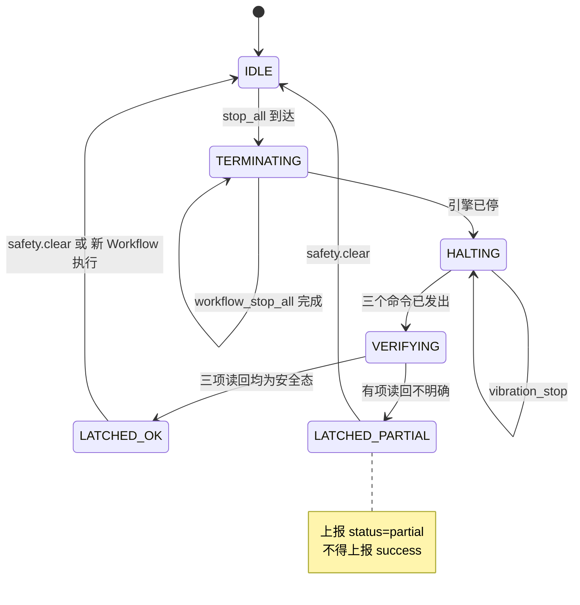
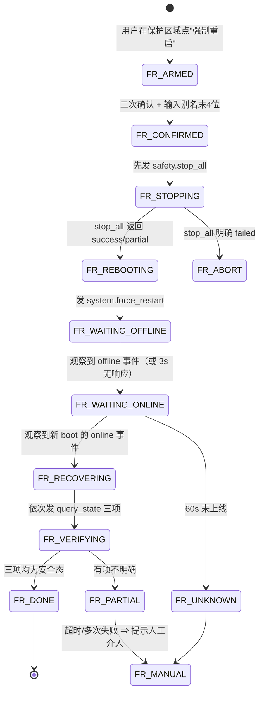

# 强制停止 Workflow 与强制重启：固件契约 + 状态机 + 测试方案

> 日期：2026-10-23 · 对应需求 §3.1 / §3.2
> 前置事实见 `10-technical-contract.md` §4（workflow_stop 的真实语义）与 §5（重启状态机、启动顺序）
> **本文件是设计，不含已实施代码。** 所有固件改动需按 §7 的清单单独评审后实施。

---

## 0. 一句话结论

| 需求 | 现状 | 结论 |
|---|---|---|
| 强制停止 Workflow | `workflow_stop()` 只清账本，**不碰硬件**，且**没有 MQTT 入口** | **可做**，物理停止函数已齐备；需新增「安全停堆」编排 + 新命令入口 |
| 普通重启遇 Critical Operation 拒绝 | 现状是**无限等待**，不是拒绝 | 需新增「预检」语义；UI 侧可先查 `restart_status` 但**不原子** |
| 强制重启 | **不存在** | **可做但高风险**，需 Flash 写保护闸门 + 启动安全初始化 |
| 重启后执行器安全核查 | 无 | 需新增 `safety.status` 读回能力（可复用现有 `query_state`） |

---

## 1. 强制停止：为什么不能直接调 `workflow_stop()`

`workflow_stop()` 的实现（`workflow.cpp:4657`）只做四件事：释放 Critical Operation、`state=IDLE`、
`current_step=0`、清 `cmd_id`/`finish_callback`。

它**不做**的三件致命的事：

1. **不停硬件** —— 阀门继续出水、步进继续转、振动继续振
2. **不通知云端** —— `finish_callback` 被置空 ⇒ 原本挂着的 `cmd_id` 永远收不到 `workflow_result` ⇒ 云端停在"运行中"
3. **不阻止并发** —— 若同一 loop 内 workflow 已经进入下一步的 `start`，stop 之后仍可能启动执行器

⇒ **强停必须是"三层动作"，缺一层就是假的强停：**

```
第 1 层（账本）  workflow_stop_all()        —— 让 Workflow 引擎不再推进
第 2 层（电气）  valve_force_close() + stepper_emergency_stop() + vibration_stop()
第 3 层（证实）  读回每个执行器的实际状态，逐项确认后上报终态
```

---

## 2. 强制停止：命令契约（拟议）

### 2.1 命令形态

```json
// 一级命令：c = "safety"
{"c":"safety","i":"<cmd_id>","p":{"o":"stop_all","reason":"user_estop"}}
```

- 走 **`system_router` 同级的独立 router**，不改 `workflow.*` 的既有语义
- **不用** `c="action"` 承载 —— 因为它会被 Workflow 当成一个 step 调用，造成"停止动作自己在 workflow 里"的语义死锁
- 不用 `p.o` 之外的花样：`o` 是对象名，与现有 `system` 风格一致

### 2.2 响应（终帧）

```json
{"cmd":"result","id":"<cmd_id>","status":"success"|"partial"|"failed",
 "terminated":[{"workflow":"wf_valve_20g","slot":3,"was":"RUNNING","current_step":2}],
 "actuators":{
   "valve":    {"action":"force_close","ok":true, "verified_open":false},
   "stepper":  {"action":"emergency_stop","ok":true, "verified_busy":false},
   "vibration":{"action":"stop","ok":true, "verified_active":false}
 },
 "latched":true, "ts":<unix>}
```

- `status` 三值：全部核实通过 = `success`；有执行器未核实 = `partial`；核心失败 = `failed`
- **`partial` 必须被 UI 显示为"未完全确认"**，不得降级成成功

### 2.3 幂等与重复请求

| 情形 | 行为 |
|---|---|
| 重复 `stop_all`（不同 cmd_id） | **总是执行**（安全方向，不判重复），回 `status=success` + `already_idle` 标记 |
| 重复同一 cmd_id（<30 s） | 设备侧静默丢弃（既有机制）⇒ UI 必须等 30 s 或换 id |
| 无任何 workflow 在跑 | `terminated: []`，仍然关全部执行器（**这是特性**：用户按急停就是要"确认都停了"） |
| 设备正在重启 | 消息不会到达；UI 按 §5 的超时判定 Unknown |

### 2.4 与正常 Action 并发

**时序保证（固件侧必须实现的顺序）：**

```
① 置 latched = true                    ← 先立牌子
② workflow_stop_all()                  ← 让引擎不再推进
③ 逐个执行器物理停止（阀 → 步进 → 振动）
④ 读回每个执行器状态
⑤ 组帧上报
```

- `latched` 的作用：在 ④ 完成前，**任何 `workflow_action_start` 一律拒绝**（返回 `ACTION_FAILED` + 事件），
  防止"同一 loop 内已排队的下一步在 ③ 之后又把阀打开"
- `latched` 的解除：**只能由显式 `{"c":"safety","p":{"o":"clear"}}` 或一次新的 Workflow 手动执行**解除
  ⇒ 不支持"自动过期"，否则会出现"以为停了、其实解除了"的窗口
- **单发 Action（`c="action"`）不受 `latched` 限制** —— 那是人工的单步操作，
  若也拦掉，用户会卡在"急停后什么都不能做"的死局里

### 2.5 网络中断 / 重启 / 结果丢失

| 故障 | 设备侧 | UI 侧 |
|---|---|---|
| 命令没到设备 | 无任何变化 | 超时 → `Unknown`，**禁止自动重发**，提示"请检查设备在线"后允许人工再发（新 cmd_id） |
| 命令到了但 result 丢了 | 执行器已停、`latched=true` | 超时 → `Unknown`，但可用 `query_state` **独立核实**三个执行器 ⇒ 若全部为安全态，可标 `confirmed_by_state` |
| 执行中设备重启 | 重启后进 `safety_outputs_init()`（§4.3） | 用 `boot` 事件识别新实例，走 §5 的恢复核查 |

★ **`Unknown` 不允许自动重试**，这是需求 §P0-3 的硬约束。

---

## 3. 强制停止：状态机

### 3.1 设备侧



- 全流程**非阻塞**：每 loop 推进一步，`VERIFYING` 阶段最多等 3 个 loop（约 30 ms）
- 硬上限：`ESTOP_MAX_MS = 2000`，超时即按 `partial` 上报（绝不无限等）

### 3.2 UI 侧（9 态，与 `05-command-lifecycle.md` 的九态对齐）

| 态 | 触发 | 用户看到 | 允许的动作 |
|---|---|---|---|
| `T_REQUESTING` | 点了"强制停止" | 转圈"正在停止…" | 取消（仅取消等待，**不撤销命令**） |
| `T_PUBLISHED` | Worker 200 | "命令已发出，等待设备确认" | 无 |
| `T_ACKED` | 收到 ack（若有） | "设备已收到" | 无 |
| `T_DONE` | `status=success` | "已停止（已核实）" + 三个执行器绿点 | 重新运行 Workflow |
| `T_PARTIAL` | `status=partial` | "已发出停止，**部分执行器未能确认**" + 逐项红/黄点 | 重试（新 cmd_id）/ 用单发关阀 |
| `T_FAILED` | `status=failed` | 失败原因 | 重试 / 强制重启（高风险） |
| `T_TIMEOUT` | 15 s 无 result | "结果未知" | 用「读取设备状态」核实 / 重试 |
| `T_UNKNOWN` | result 到但无法解析/矛盾 | "结果未知" | 同上 |
| `T_SUPERSEDED` | 设备 boot 变了 | "设备已重启，本次结果作废" | 走 §5 恢复流程 |

### 3.3 安全目标逐条对照

| 需求原文 | 本设计的满足方式 |
|---|---|
| 停止后不允许后续步骤继续启动执行器 | `workflow_stop_all()` + `latched` 双保险 |
| 所有受控执行器进入安全状态（阀关/步进停/振动停） | 第 2 层三个物理停止函数 |
| RTC/OLED 不因强停关闭 | 停止清单**只含三个执行器**，不含 `rtc`/`oled`/`time`/`mqtt` |
| 不得仅靠前端取消/停止轮询宣称已停 | 必须有 `status=success` 或 `query_state` 独立核实，否则显示 `partial`/`Unknown` |
| 检查 Action 执行机制、排队、优先级 | §2.4 的 5 步时序 + `latched` |
| 无法确认时显示 Unknown | `T_TIMEOUT` / `T_UNKNOWN` / `T_PARTIAL` |

---

## 4. 强制重启

### 4.1 与"普通重启"的语义分离

| | 普通重启 `system.restart` | 强制重启 `system.force_restart`（拟议） |
|---|---|---|
| 等待 Critical Operation | **等**（现状无限等） | **不等**（记录未完成的 op 数并跳过） |
| 安全窗口 | 10 000 ms | **300 ms**（只为把 result 帧发出去） |
| 前置动作 | 无 | **先执行 §2 的 stop_all**（同一命令内编排） |
| Flash 写入中 | 等待（写操作本身持有 Critical Operation） | **拒绝**（见 §4.2） |
| 风险提示 | 无 | 必须二次确认 + 输入设备别名末 4 位 |

### 4.2 Flash 写保护闸门（新增，必须）

强制重启最大的真实风险**不是电气**，是**打断 Flash 写入**：

| 写入者 | 后果 |
|---|---|
| `config_save` | Active 写一半 ⇒ 靠 Backup + `boot_ok` 回滚（**设计内有保护**） |
| `workflow.save` | 文件可能半写；`workflow_storage` 有事务/镜像机制 **[待验证具体强度]** |
| `bin_storage` / log Flash 队列 | 可能丢尾部记录（可接受） |
| `json_storage` | 可能损坏 JSON（**无保护**） |

**闸门规则**：`system_command_force_restart()` 必须检查一个新增的 `s_flash_write_busy` 标志：

```
if (flash_write_busy) → 拒绝，回 e=<新错误码> "flash write in progress, force restart refused"
```

- `flash_write_busy` 由 `config_manager` / `workflow_storage` / `json_storage` 的写入路径置位/清位
- 实现成本：低（3 处 acquire/release 包裹，语义与 `critical_operation` 类似但**独立计数**）
- **没有这个闸门，强制重启就是"随机损坏配置"的赌局** ⇒ 这是本设计的**准入条件**

### 4.3 启动安全初始化（`safety_outputs_init()`）

**位置（硬约束）**：`config_init()` 之后、`ble_init()` / `wifi_init()` **之前**。

```cpp
// 伪代码 —— 只做 GPIO 电平，不注册 Action、不启动模块、不碰日志
void safety_outputs_init()
{
    // 1) 电磁阀：默认关
    int pin = config_get_valve_gpio_pin();
    if (pin >= 0) { gpio_set_level_safe(pin, !config_get_valve_active_level()); }

    // 2) 步进 EN：默认失能（en_active_level=0 ⇒ 写 1 = 失能）
    int en = config_get_stepper_en_pin();
    if (en >= 0) { gpio_set_level_safe(en, !config_get_stepper_en_active_level()); }

    // 3) 振动继电器：默认关
    int vib = config_get_vibration_relay_pin();
    if (vib >= 0) { gpio_set_level_safe(vib, !config_get_vibration_active_level()); }
}
```

要点：
- **必须在 `digitalWrite` 之前 `gpio_config(OUTPUT)`**，否则写不进去（Arduino 的 `pinMode` 亦可）
- 顺序上是"先配成输出并写安全电平"，**不是**"先写再配"（避免上拉/下拉瞬间误触发）
- 三者的 `active_level` 都来自 config，**不得硬编码**（继电器有高/低触发两种模块）
- 失败（pin<0 或 config 读不到）⇒ **不阻塞启动**，但必须 `Serial` 打印 + 在 boot 日志里记一条 WARN

### 4.4 强制重启状态机（UI）



**超时与重试边界（写死，不得放宽）**：

| 阶段 | 超时 | 重试 |
|---|---|---|
| `FR_STOPPING` 等 stop_all 结果 | 15 s | 1 次（新 cmd_id） |
| `FR_WAITING_OFFLINE` 等 offline 事件 | 5 s | 无（offline 事件可能丢，直接进下一步） |
| `FR_WAITING_ONLINE` 等新 boot online | **60 s** | 无（不自动重发重启命令） |
| `FR_VERIFYING` 每项 `query_state` | 8 s | 2 次，间隔 3 s / 8 s（总 ≤ 22 s） |
| `FR_PARTIAL` 后自动再核 | 30 s 内每 5 s 一次，最多 6 次 | 超限 → `FR_MANUAL` |

**"新 boot 的 online 事件"如何识别**（关键）：
- presence 只给 `online/offline`，**不带 boot_id**
- **[拟议]** 用 `query_state` 读取 `stepper.last_result` 等"重启会归零"的状态？⇒ 不可靠
- **可行方案**：先 `workflow.sync_info` 或 `registry` 拿 `version`？—— 重启后不一定变
- **★ 真正可靠的最小方案**：读取设备 `system.time`（`get_time`）→ 若返回的系统时间明显晚于重启前，
  说明是新实例；但这依赖 NTP，**不可靠**
- **结论**：**当前没有可靠的"重启实例标识"**。因此：
  - 阶段 2 给 `query_state` 增加一个 `boot_seq`（或 `uptime_ms`）键 —— 这是**很小的固件改动**
    （`state_map[]` 加一项 + 启动时自增并持久化到 `version.json`）
  - **在 `boot_seq` 存在之前，UI 只能显示"设备已重新上线，但无法证明这是重启后的新实例"**，
    并把该流程标记为 `partial`

> ★ 这一条是 §3.2 的**真实阻塞点**。用户要求"设备重新上线后，UI 识别这次重启对应的设备实例"，
> 现有协议**不支持**。加 `boot_seq` 是最小代价，但它是固件改动，需单独批准。

---

## 5. 重启后的执行器安全核查（逐项）

| 执行器 | 核查用的键 | 安全值 | 若读到非安全值 |
|---|---|---|---|
| 电磁阀 | `query_state o=valve_status` | `0` / `closed` | 发 `VALVE_CLOSE`（单发 action，需 registry v/k） |
| 电子秤 | `o=weight_valid` / `o=weight_error` | `valid=true` | 不自动处理；仅提示（秤不影响安全） |
| 步进 | `o=stepper_busy` | `false` | 发 `STEPPER_EMERGENCY_STOP` |
| 振动 | `o=vibration_active` | `false` | 发 `VIBRATION_STOP` |
| 重启状态 | `system.restart_status` | `state=idle` | 说明还在重启中，继续等 |

**只有上表 4 项全部为安全值**，才能标 `FR_DONE`。
任一项读不到（超时/设备又掉线）⇒ `FR_PARTIAL`，**不得自动宣布成功**（用户要求原文）。

---

## 6. 测试方案

### 6.1 分层（沿用项目既有口径）

| 层 | 内容 | 需要硬件 |
|---|---|---|
| T0 编译 | `pio run -e ...` 通过 + 构建后整体余量检查（Flash <85% / RAM 不放缓） | 否 |
| T1 协议 | 串口注入 `stop_all` / `force_restart` 报文，验证回帧结构 | 是（有串口即可） |
| T2 回帧 | MQTT 下发 + 串口观察 + `mqtt_messages` 交叉验证 | 是 |
| T3 物理 | 阀真关、步进真停、振动真停（万用表 / 目视 / 声音） | 是，且**空载** |

### 6.2 用例（强制停止）

| # | 场景 | 期望 | 层 |
|---|---|---|---|
| ES-01 | 无 workflow 运行时 stop_all | `success`，`terminated=[]`，三执行器均安全 | T1 |
| ES-02 | `wf_valve_20g` 运行到开阀步骤时 stop_all | 阀在 <1 s 内关闭，`terminated` 含该 wf 且 `current_step=2` | T3 |
| ES-03 | 连发两次 stop_all（不同 id，间隔 100 ms） | 两次都成功，第二次 `already_idle=true` | T1 |
| ES-04 | stop_all 后立刻再跑同一 workflow | `latched` 期间被拒；`clear` 后可正常跑 | T2 |
| ES-05 | stop_all 后拔网线 | 执行器仍保持安全（停是设备侧动作，与网络无关） | T3 |
| ES-06 | stop_all 到达瞬间设备 reboot | UI 进 `T_SUPERSEDED` → 走 §5 | T2 |
| ES-07 | 振动 `duration_ms=0`（持续）时 stop_all | 振动真停 | T3（**依赖振动真机验证**） |
| ES-08 | 步进旋转中断言 RMT 已停 | `stepper_busy=false` 且无残留脉冲（示波器） | T3（**依赖 DRV8825 到货**） |
| ES-09 | result 帧人为丢弃 | UI 15 s 后显示 Unknown，可用 `query_state` 核实 | T2 |
| ES-10 | `latched` 期间 `latched` 断电器重启 | 重启后 `latched` 复位为 false（不持久化） | T1 |

### 6.3 用例（强制重启）

| # | 场景 | 期望 | 层 |
|---|---|---|---|
| FR-01 | 无 Critical Operation 时强制重启 | 300 ms 内 reboot，result 帧能发出 | T2 |
| FR-02 | **config_save 进行中**强制重启 | **被拒绝**，错误码明确 | T2 |
| FR-03 | 阀开启状态强制重启 | 重启后阀为关闭；`safety_outputs_init` 生效 | T3 |
| FR-04 | 重启后 60 s 未上线 | UI 进 `FR_MANUAL`，不自动重发 | T2 |
| FR-05 | 重启后 `valve_status` 读回失败 | `FR_PARTIAL`，不显示成功 | T2 |
| FR-06 | 连续两次强制重启（间隔 5 s） | 第二次被拒（`RESTARTING` 或刚启动） | T1 |

### 6.4 真机前置条件（缺一不可）

1. 设备已连接、`pio device list` 可见
2. **阀接好且水路在可控容器上**（能目视 45 s 出水不淹）
3. 步进/振动真机验证**尚未通过** ⇒ ES-07 / ES-08 **标记为"待硬件"**，不得作为阶段 4 完成条件
4. 强制重启测试前，**确认没有正在进行的 config/workflow 保存**

---

## 7. 固件修改清单（供单独批准）

| # | 文件 | 改动 | 依赖 | 风险 | 回滚 |
|---|---|---|---|---|---|
| F-1 | `src/app/safety.cpp/.h`（新） | `safety_outputs_init()` / `safety_stop_all()` / `latched` 标志 | 无 | 低（新文件，默认不改变旧行为） | 删文件 + 撤调用 |
| F-2 | `src/main.cpp` | `config_init()` 后调 `safety_outputs_init()` | F-1 | **中**（改变了启动期 GPIO 行为） | 注释该调用；保留 `valve_init()` 原路径 |
| F-3 | `src/services/command_manager.cpp` | 新增 `safety_router`（`stop_all` / `clear`） | F-1 | 低（新增分支） | 删分支 |
| F-4 | `src/services/system_command.cpp` | `system_command_force_restart()` + `flash_write_busy` 闸门 | F-5 | **高**（新增重启路径） | 保留开关宏默认关闭 |
| F-5 | `config_manager` / `workflow_storage` / `json_storage` | 写路径置位 `flash_write_busy` | F-4 | 中（触碰持久化路径） | 独立提交，可单独回退 |
| F-6 | `src/services/system_state.cpp` | 新增 `STATE_BOOT_SEQ` + `state_map[]` 加项 | F-7 | 低 | 删项 |
| F-7 | `src/services/device_identity.cpp` 或 `version.json` | `boot_seq` 自增并持久化 | — | 低（一次 Flash 写/启动） | 保留读、不写 |
| F-8 | `src/app/valve.cpp` | `safety_timeout_sec` 默认值来源改为 config 默认（见 `12` §4） | — | 低 | 改回常量 |

**F-4 的准入条件**：F-5 必须先合入并测过。**没有 Flash 闸门的强制重启不得合入。**

**Capability Registry 影响**：若把 `stop_all` 做成 Action，会重排全部 stable_id 并递增 `v`
（`v:4 → v:5`）⇒ 所有云端缓存的 `k` 全部失效。
⇒ **本设计故意不把它做成 Action**，而是独立一级命令，**理由就是不破坏 registry 稳定性**。
