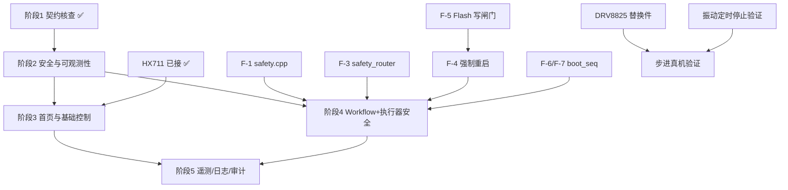

# 五个阶段的拆分、依赖与验收矩阵

> 日期：2026-10-23 · 替代 `09-milestones.md` 的排期部分（`09` 保留为历史记录）
> 阶段划分遵循用户给定的五阶段顺序，**不因原型已基本满意而跳过技术前置**。

---

## 0. 一页看懂

```
阶段 1  只读契约核查        ✅ 本轮完成（10-technical-contract.md）
   │
阶段 2  安全与可观测性后端   ← 阻塞一切控制功能；无硬件依赖，可立即开工
   │        ├ P2-a 鉴权三处（P0-A/B）
   │        ├ P2-b 回帧只读端点（P0-C）
   │        ├ P2-c command_audit + 迁移 0008（P0-D）
   │        ├ P2-d 服务端去重 / 幂等（P0-F）
   │        └ P2-e Registry/Workflow/Config 读取接口 + 版本校验
   │
阶段 3  首页与基础控制       ← 依赖 2；只需阀 + 秤（已真机验证）
   │
阶段 4  Workflow 编辑器 + 执行器安全 ← 依赖 2；强停/强重启依赖固件改动
   │
阶段 5  遥测、日志解码、审计完善 ← 可与 4 并行
```

**唯一硬串行点**：阶段 2 → 阶段 3/4。**阶段 4 的"强停"子项**额外依赖固件 F-1/F-3（见 `15-firmware-change-list.md`）。

---

## 1. 各阶段规格

### 阶段 1 · 只读技术契约核查（✅ 本轮完成）

| 项 | 内容 |
|---|---|
| 目标 | 把"真实行为"写成可验收的契约，找出全部 P0 缺口 |
| 交付 | `10-technical-contract.md`（含 P0-A~P0-J）、`12`（参数目录）、`13`（同步）、`11`（强停/重启设计） |
| 不修改 | 任何生产代码 |
| 退出条件 | 10 条 P0 缺口有明确修法；每条新需求都能对应到"能/不能/待验证" |
| 阻塞 | 无 |

### 阶段 2 · 安全与可观测性后端

| 项 | 内容 |
|---|---|
| **目标** | 让"命令"这件事**可信**：谁发的、发给谁、设备有没有收到、执行结果是什么 |
| 前置 | 阶段 1 完成；`0008` 迁移评审通过 |
| 范围 | P0-A 鉴权三处 / P0-B Worker Bearer / P0-C 回帧端点 / P0-D 审计表 / P0-E 写入失败语义 / P0-F 服务端去重 / P0-J 元数据目录（只建目录，不接 UI） |
| **不含** | 任何 UI 页面、任何固件改动、任何 EMQX 改动 |
| 验收 L1 | 匿名 `POST /api/command` → 401；伪造 cookie → 401；跨站提交 → 403（CSRF） |
| 验收 L2 | 直连 Worker 根路径无 Bearer → 401 |
| 验收 L3 | 发一条 `VALVE_CLOSE`，能在 `GET /api/history/command?cmd_id=` 查到 `published` 记录 |
| 验收 L4 | 设备回帧后同一端点能查到 `result`，且 `cmd_id` 匹配（**需真机**） |
| 验收 L5 | 同一 `cmd_id` 并发两次 → 第二次返回幂等结果，设备只收到一次 |
| 退出条件 | L1~L3 全绿（L4/L5 需设备，可标"待真机"但**不得**标通过） |
| 阻塞 | 无硬件阻塞 ⇒ **可立即开工** |
| 风险 | 改鉴权会**打断现有 Pages 页面**（`app.html` 无 token 逻辑）⇒ 需同时给 `app.html` 加最小登录态检查 |

### 阶段 3 · 首页与基础控制

| 项 | 内容 |
|---|---|
| 目标 | 手机上能诚实看到"现在能不能喂"，并能安全地开关阀、出粮、清零 |
| 前置 | 阶段 2 的 L1~L3 |
| 范围 | 首页（别名/在线时长/重量/阀状态/快捷操作可配）、控制页（供水/出粮/脉冲/振动/测试/清零移入详情）、设备列表与别名、底部导航、命令四态条、布局持久化（localStorage） |
| **不含** | Workflow 编辑、强制停止、强制重启、遥测曲线、日志解码 |
| 验收 | 见 §3 矩阵的 S3-01~S3-12 |
| 阻塞 | 无（阀+秤已真机验证） |
| 风险 | 快捷操作数量变化会挤压安全状态 ⇒ 按 `12` §1.2 的折叠规则实现并**逐数量截图验收**（0/1/2/4/8/12） |

### 阶段 4 · Workflow 编辑器 + 执行器安全

| 项 | 内容 |
|---|---|
| 目标 | 能改供水目标量并跑起来；能真正停得下来 |
| 前置 | 阶段 2 全部；**强停**依赖固件 F-1/F-3；**强重启**依赖 F-4/F-5（且 F-5 必须先合入） |
| 范围 | 列表/详情/编辑器（步骤增删改排序、参数表单、两阶段保存）、运行、正常停止、**强制停止**、普通重启、**强制重启**、重启后安全核查 |
| **不含** | 步进/振动的"已验证"标识（硬件未验证）、按克直接供水（明确不做） |
| 验收 | S4-01~S4-14 |
| 阻塞 | **强停**：无硬件阻塞（物理停止函数已存在，但需真机验证 ES-02/ES-07/ES-08）；**强重启**：被 F-5 Flash 闸门阻塞，且 V-4 未验证 |
| 风险 | ★ 最高风险阶段。任何"UI 说停了其实没停"的实现都不可接受 |

### 阶段 5 · 遥测、日志解码与完善

| 项 | 内容 |
|---|---|
| 目标 | 让数据可读、可追溯；补齐异常态与回归 |
| 前置 | 阶段 2（审计）；阶段 3（页面骨架） |
| 范围 | 遥测曲线（温度/湿度/重量）、日志 CBOR 解码、操作审计页（筛选/导出）、异常态（会话过期/离线/403/空数据/接口错）、回归测试 |
| **不含** | 桌面/平板专用布局（明确不是本轮验收要求） |
| 验收 | S5-01~S5-08 |
| 阻塞 | 无（日志样本已有，解码器已有） |

---

## 2. 依赖关系



**关键路径**：`S2 → S4`（强停）；`F5 → F4 → S4`（强重启）。
**非关键但有风险**：`F6/F7 (boot_seq)` 未做时，§3.2 的"识别设备实例"只能标 `partial`。

---

## 3. 验收矩阵

图例：**L1** 请求被接受 · **L2** 已发布 · **L3** 设备已确认 · **L4** 执行终态 · **P** 物理证据
`硬件` 列：`—` 不需要 / `串口` 只需串口 / `真机` 需设备 + 执行器

### 阶段 3

| ID | 验收项 | 层 | 硬件 | 通过标准 |
|---|---|---|---|---|
| S3-01 | 首页显示别名 + 在线时长 | L1 | — | 时长为 §13.3 格式，非裸秒数 |
| S3-02 | 离线时显示"最后在线 X 前" | L1 | — | 时长停止递增 |
| S3-03 | `stale=true` 不显示为离线 | L1 | — | 显示 ◐ 半在线 |
| S3-04 | 快捷操作 0/1/2/4/8/12 五种数量 | — | — | 安全状态四要素始终首屏可见 |
| S3-05 | 布局持久化 + 恢复默认 | — | — | 刷新后保持；恢复默认二次确认 |
| S3-06 | 开阀二次确认 | — | — | 确认框含 device 别名 + 当前重量 + 关阀时间 |
| S3-07 | 关阀一条命令 | L4 | 真机 | 阀门实际关闭（P） |
| S3-08 | 出粮 120° | L4 | 真机 | **标"未验证"**，不要求通过 |
| S3-09 | 指定脉冲输入校验 | — | — | 上下限来自设备实际 `max_pulses` |
| S3-10 | 清零已从常用控制移除 | — | — | 常用控制区无"清零" |
| S3-11 | 命令四态正确 | L1~L4 | — | `accepted` 不显示为成功 |
| S3-12 | 会话过期 / 403 / 空数据 / 接口错 | L1 | — | 四种态都有明确文案 |

### 阶段 4

| ID | 验收项 | 层 | 硬件 | 通过标准 |
|---|---|---|---|---|
| S4-01 | Workflow 列表（含 valid=false 不显示） | L1 | — | — |
| S4-02 | 编辑器增删改排序步骤 | L1 | — | 排序 = 整份 `workflow.set` 重写 |
| S4-03 | 参数表单范围来自云端目录 | — | — | 不失焦时即校验；提交前再校验 |
| S4-04 | 两阶段保存（set → save） | L3 | 串口 | save 返回新 `registry_version` |
| S4-05 | save 后设备重启并重新同步 | L3 | 真机 | 重启后 `v` 与本地一致 |
| S4-06 | 运行 Workflow | L4 | 真机 | `WF_FINISHED STEPS_DONE=4`（已实测基线） |
| S4-07 | **正常停止** | L4 | 真机 | 阀关、状态 IDLE、收到终态帧 |
| S4-08 | **强制停止** | L4+P | 真机 | 阀在 <1 s 关；三项执行器状态读回安全 |
| S4-09 | 强停后 `latched` 生效 | L3 | 串口 | 新 workflow 被拒；`safety.clear` 后恢复 |
| S4-10 | 强停结果 `partial` 不显示成功 | — | — | — |
| S4-11 | 普通重启：Critical 存在时**拒绝**并说明 | L3 | 串口 | 需固件新增预检语义 |
| S4-12 | 强制重启：Flash 写入中**拒绝** | L3 | 串口 | 需 F-5 |
| S4-13 | 强制重启后安全核查逐项 | L4 | 真机 | 四项全绿才标成功 |
| S4-14 | boot_seq 识别新实例 | L3 | 串口 | 无 boot_seq ⇒ 只能标 `partial` |

### 阶段 5

| ID | 验收项 | 层 | 硬件 | 通过标准 |
|---|---|---|---|---|
| S5-01 | 遥测三条曲线 | L1 | — | 用真实 `telemetry_history` 数据 |
| S5-02 | 日志解码（正常样本） | — | — | `LogLevel`/`ts=0`/字符串参数都正确 |
| S5-03 | 日志解码（非法样本） | — | — | 非法偏移/未知版本 → 降级显示，不白屏 |
| S5-04 | 审计页按 cmd_id 检索 | L1 | — | — |
| S5-05 | 审计导出 | L1 | — | CSV，脱敏 |
| S5-06 | 90 天保留策略生效 | — | — | 需与 `retention.js` 对齐 |
| S5-07 | 回归：阶段 3 全部用例 | — | — | 不退化 |
| S5-08 | 移动端（375/390/414 宽）适配 | — | — | 无横向滚动 |

### 阶段 2

| ID | 验收项 | 层 | 硬件 | 通过标准 |
|---|---|---|---|---|
| S2-01 | 匿名命令 → 401 | L1 | — | — |
| S2-02 | 直连 Worker 无 Bearer → 401 | L1 | — | — |
| S2-03 | CSRF 缺失/错误 → 403 | L1 | — | — |
| S2-04 | 回帧端点能查到 published | L3 | — | — |
| S2-05 | 回帧端点能查到 result | L4 | 真机 | — |
| S2-06 | 并发同 cmd_id 只下发一次 | L2 | 串口 | 串口只见 1 帧 |
| S2-07 | D1 写失败 → 5xx 且不谎报成功 | L1 | — | 注入故障测试 |
| S2-08 | 审计表按 cmd_id 唯一 | L1 | — | UNIQUE 约束 |
| S2-09 | 元数据目录覆盖 14 Action + 3 Trigger | — | — | 与 `02` 能力目录逐项对得上 |

---

## 4. 无硬件可做 / 必须等设备

### 4.1 现在就能做（设备未连接也安全）

| 类别 | 具体 |
|---|---|
| 阶段 2 全部 | Pages/Worker/D1 改动 + 迁移评审 + 单测 |
| 原型迭代 | `prototype.html` / `layout.html` |
| 固件静态改动 | F-1（新文件）、F-3（新增分支）、F-6/F-7（boot_seq 骨架）合并前需编译 + 串口测 |
| 文档 | 全部 |
| 解码器测试 | `docs/scripts/decode_log_history.py` 用历史样本跑回归 |

### 4.2 必须等设备连接

| 项 | 为什么 |
|---|---|
| 任何 `pio run -t upload` | 需 COM 口 |
| S2-05（result 回帧关联） | 需设备真的回帧 |
| S4-06~S4-10（Workflow 与强停） | 需阀动作 |
| S4-13（重启后核查） | 需真机重启 |
| 配置实值核对 | 仓库值 ≠ 设备实值 |
| F-2（启动安全初始化）的**电气验证** | 需万用表测继电器输入 |
| 步进/振动真机 | **需 DRV8825 替换件**（当前损坏） |

### 4.3 用户必须亲自做的物理验证

1. **继电器在 GPIO 高阻（复位后 ~200~1500 ms）时的实际行为** —— 万用表测 IN 脚电压
2. 步进换向 / 120° 真实角度 —— 目视 + 量角
3. 振动定时停止 —— 目视计时
4. 阀关闭后是否真无水流（当前已验证过一次 21 g 闭环，但 `safety_timeout` 改 60 s 后需重测）

---

## 5. 阶段交付格式（每个阶段必须报告）

| 项 | 说明 |
|---|---|
| 修改文件 | 逐条路径 + 一句话目的 |
| 与既有架构的关系 | 新增/替换/旁路（**旁路必须解释**） |
| 自动化测试 | 跑什么、结果、覆盖了哪几条验收 |
| 编译结果 | `pio run` 输出摘要 + Flash/RAM 余量（G-1/G-2） |
| 尚未验证的行为 | 明确列 |
| 需真机验证 | 明确列 |
| 回滚方式 | git revert / 开关宏 / 配置项 |
| 下一阶段阻塞条件 | |

---

## 6. 回滚策略（总表）

| 改动 | 回滚方式 | 是否需重刷 |
|---|---|---|
| 云端 Pages/Worker 代码 | 重新部署上一版（`wrangler rollback`） | 否 |
| D1 迁移 `0008` | **不可回滚**（D1 不支持 down）⇒ 必须先备份 + 只做加法（新表/新列） | 否 |
| 固件 F-1/F-3 | 删文件 + 撤调用 | 是 |
| 固件 F-2（启动安全初始化） | 注释该行调用（保留函数） | 是 |
| 固件 F-4（强制重启） | 开关宏 `GF_ENABLE_FORCE_RESTART` 默认 0 | 是 |
| 固件 F-5（Flash 闸门） | 独立 commit 回退 | 是 |
| 固件 F-8（阀默认 60 s） | 改回 300；**但设备实值不随之变**（需 `config_set` 显式改） | 是 |
| 前端布局 | 清 `localStorage` key | 否 |

★ **`0008` 迁移只做加法**（`CREATE TABLE` / `ALTER TABLE ADD COLUMN`），
不做 `DROP`/改列，确保"部署了但不能回滚"不至于毁数据。
